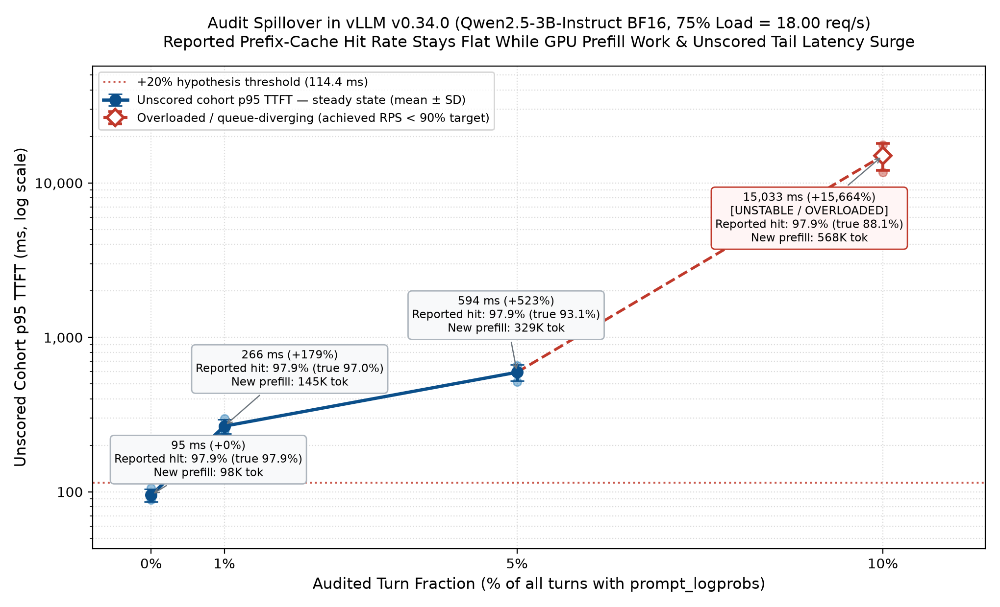

# vLLM `prompt_logprobs` Spillover Benchmark: Can Auditing 5% of Agent Turns Slow the Other 95%?

Empirical vLLM `v0.34.0` serving benchmark measuring cross-cohort tail-latency spillover when a sample of production agent turns requests full-prompt log probabilities (`prompt_logprobs`).

## Mechanism & Hypothesis

- **Mechanism (vLLM v0.34.0)**:
  - When a request sets `prompt_logprobs`, `Request.get_prefix_cache_hit_limit()` returns `0`, causing `KVCacheManager.get_computed_blocks()` to bypass prefix-cache reads and recompute full-prompt prefill.
  - `KVCacheManager.record_prefix_cache_stats()` skips requests where `prefix_cache_lookup_enabled(request)` is `False`, excluding those skipped lookups from `vllm:prefix_cache_queries` and `vllm:prefix_cache_hits`.
  - Meanwhile, `prompt_logprobs > 0` is rejected when `stream=True` (`vllm/entrypoints/openai/completion/protocol.py`), so audited turns and their matched controls must use the nonstreaming `/v1/completions` endpoint.
- **Hypothesis**:
  - At **75% of measured baseline capacity**, auditing **5% of turns** raises **p95 TTFT** for a separate, unscored streaming cohort by **at least 20%**, while the reported prefix-cache hit ratio moves by **less than 3 percentage points**.

## Experimental Design

- **Server**: `vllm==0.34.0` serving `Qwen/Qwen2.5-3B-Instruct` in `bfloat16` on 1× NVIDIA A100-SXM4-80GB (`GPU 0`, port `8025`), `--enable-prefix-caching`, `--generation-config vllm` (with explicit `repetition_penalty=1.0` so HF's `generation_config.json` does not add repetition-penalty compute), and pre-warmed `prompt_logprobs` Triton kernels (`k ∈ {0, 1, 5}`) before prefix-cache reset and timing.
- **Workload**: 24 seeded, 32-turn sessions (768 total turns) with **staggered starting turn depths** across sessions (and pre-primed rollover histories) so the aggregate prompt-length distribution is stationary across the entire replay (`4,224 -> 8,192` prompt tokens, exact `6,208.0` mean prompt tokens per quarter), fixed `output_tokens=64`, `ignore_eos=True`, `temperature=0.0`.
- **Cohort & Client Isolation**:
  - **Sessions 0–15 (512 turns)**: Separate, unscored streaming measurement cohort (`stream=True`, never audited across any condition), executed in its **own isolated OS process** synchronized via `CLOCK_MONOTONIC` so nonstreaming logprob payload downloads/JSON decoding cannot stall streaming timers or SSE reads.
  - **Sessions 16–23 (256 turns)**: Nonstreaming audit/control pool (`stream=False` in all conditions, with JSON parsing deferred strictly post-run). Audited turns are nested subsets (`1% ⊂ 5% ⊂ 10%`) within each replicate, paired against exact nonstreaming matched controls at `0%` and a `5%` **cache-miss-only control** (token 0 mutated, `prompt_logprobs` unset). `audit_seed` varies across replicates (`9000 + arrival_seed`).
- **Arrival Schedule**: Stationary round-robin turn-shuffled Poisson arrivals (fixed per arrival seed: `101, 202, 303`) with boundary separation so consecutive turns of the same session do not collide and there is no ramp-down tail bias.
- **Metrics**:
  - Client-side per-request TTFT, E2E, TPOT (`(t_end - t_first) / (completion_tokens - 1)`), TTFB, body transfer time, dispatch lag, and response payload bytes (`requests.jsonl`).
  - Server-side Prometheus `/metrics` deltas before/after each replay: `vllm:prefix_cache_hits` / `vllm:prefix_cache_queries` (reported hit ratio), `vllm:request_prefill_kv_computed_tokens_sum` & `vllm:prompt_tokens_by_source{source="computed"}` (newly computed prefill tokens), `vllm:num_preemptions`, and fine-grained latency histograms (`server_ttft_s`, `server_queue_s`, `server_prefill_s`, `server_e2e_s`).

## Empirical Results (`vllm==0.34.0`, `Qwen/Qwen2.5-3B-Instruct`, 1× A100-SXM4-80GB)

All **76 benchmark runs** (58,368 total requests across calibration, main sweep, and 3 diagnostic hunts) completed with **0 errors**, **0 KV-cache preemptions**, **0 HF `generation_config` overrides**, and **0 mid-run Triton JIT compilations** (JIT completed during pre-timing warmup). Streaming client dispatch lag remained tight (`dlag_p95 = 1.9–2.7 ms` across steady-state runs and `2.45 ms` even at `k=5`).

- **Baseline Capacity Calibration (0% audit, SLO p95 TTFT ≤ 500 ms):** **`24.0 req/s`** (`p95 = 161.1 ms` at `24 req/s`, transitioning into overload at `28 req/s`).
- **Target 75% Load:** **`18.0 req/s`**.

### Main Sweep: Audit Fraction vs. Unscored Streaming Cohort (`18.0 req/s`, 3 seeds)



| Audit % | Unscored p50 TTFT | Unscored p95 TTFT (mean ± SD) | vs. 0% Baseline | Reported Hit % | True Effective Hit % | Newly Computed Prefill | Achieved RPS | Regime |
|---:|---:|---:|---:|---:|---:|---:|---:|---|
| **0%** | 62.2 ms | **95.4 ± 8.9 ms** | +0.0% | **97.94%** | 97.94% | 98,304 tok (1.0×) | 17.84 | steady |
| **1%** | 64.5 ms | **266.2 ± 28.3 ms** | **+179.1%** | **97.94%** | 96.97% | 144,555 tok (1.5×) | 17.76 | steady |
| **5%** | 138.8 ms | **594.4 ± 71.6 ms** | **+523.3%** | **97.94%** | 93.10% | 329,131 tok (3.3×) | 17.40 | steady |
| **10%** | 5,221.4 ms | **15,033.0 ± 3,005.6 ms** | **+15,664.4%** | **97.94%** | 88.08% | 568,192 tok (5.8×) | 12.42 | **UNSTABLE** |

**Hypothesis verdict — strongly confirmed:** At 75% load, auditing **5% of turns** raised unscored streaming **p95 TTFT by +523.3% (6.2×)** in steady state while newly computed prefill tokens jumped **3.3×** and the reported prefix-cache hit rate moved by **0.00 percentage points (`97.94% → 97.94%`)**. At **10% auditing**, the server entered queueing collapse (`achieved_rps = 12.42 < 0.90 × 18.0`), yet Prometheus still reported **97.94%**.

### Diagnostic Hunts

1. **Hunt 1 — Early vs. Late Turns ([hunt1_early_vs_late.png](plots/hunt1_early_vs_late.png)):** With stationary turn depths across time, auditing just **10 late turns** (1.3% of turns, `176K` new prefill tokens) raised unscored p95 TTFT to **423.4 ± 22.9 ms (+358.5%)**—worse than auditing **36 early turns** (4.7% of turns, `260K` new prefill tokens, **360.4 ± 24.8 ms / +290.3%**) or **24 early turns** (**321.8 ± 22.2 ms / +248.5%**).
2. **Hunt 2 — Mechanism Decomposition: Cache Bypass vs. Logprobs Compute & Server Serialization ([hunt2_serialization_gap.png](plots/hunt2_serialization_gap.png)):** With the streaming cohort isolated in its own OS process (`dlag_p95 = 2.45 ms` at `k=5`):
   - **`cache_miss_5pct`** (token 0 mutated, no `prompt_logprobs`): Unscored p95 TTFT reached **`333.6 ms` / `461.8 ms` / `2,339.3 ms`** across seeds (median `461.8 ms`, mean `1,044.9 ms`), showing pure prefix-cache bypass accounts for the bulk of `k=0`/`k=1` spillover—**while Prometheus accurately reports the hit-rate drop (`97.94% → 93.01%`)**.
   - **`audit5pct_k0` & `audit5pct_k1`** (`0.48 MB` / `0.87 MB`): Client p95 = **`582.0 ± 151.8 ms`** / **`602.5 ± 73.3 ms`**, closely tracking server Prometheus p95 (`525.2 ms` / `493.3 ms`)—while Prometheus goes **100% blind (`97.94%`)**.
   - **`audit5pct_k5`** (`2.44 MB` per audited turn): Client p95 surged to **`1,297.6 ± 395.6 ms`** (client p50 `389.6 ms`) vs. server Prometheus p95 **`886.0 ms`**—a genuine **`+412 ms` vLLM API-server serialization / event-loop stall** cleanly separated from client-side parsing.
   - *Measurement population note:* vLLM Prometheus latency histograms aggregate **all 768 requests** (including the 38 audited turns), whereas Client Unscored p95 covers only the **512 streaming turns**. Because including the 38 slow full-prefill turns pushes global Server p95 *upward* (visible on `cache_miss_5pct`, where server p95 exceeds client unscored p95), the `+412 ms` client-over-server gap at `k=5` is a conservative lower bound on API-server serialization overhead.
3. **Hunt 3 — Load Boundary ([hunt3_load_boundary.png](plots/hunt3_load_boundary.png)):** 5% auditing severely degraded unscored p95 TTFT across every tested load: **+425.0%** at 35% load (`68.0 → 356.9 ms`), **+496.8%** at 50% load (`73.5 → 438.7 ms`), **+554.7%** at 75% load (`92.5 → 605.7 ms`), and queueing collapse (**+4,521.6%**, `155.6 → 7,189.2 ms`, all 3 seeds unstable) at 90% load.

## Scope & Limitations

- **High-reuse multi-turn geometry (`4,096 + 128` tokens, `97.94%` baseline hit rate):** Spillover amplification scales with the ratio of cached prefix to newly appended tokens (~48:1 here, representative of long-context coding/tool-use agents). Short single-turn prompts or low-reuse workloads will experience a proportionally smaller prefill multiplier.
- **Model-to-GPU memory ratio & vocabulary size (`Qwen2.5-3B-Instruct` on A100-80GB):** This pairing provides ample KV headroom (~22% active KV utilization, `0` evictions/preemptions), isolating compute/queueing and serialization contention. Tighter memory ratios (e.g., 70B models at high concurrency) may additionally trigger KV eviction or preemption cascades. Conversely, Qwen2.5's large 151,936-token vocabulary makes full-prompt `lm_head` + `log_softmax` heavier relative to a 3B backbone than on larger models with smaller vocabularies.
- **Unpinned chunked-prefill budget:** `start_server.sh` uses vLLM `v0.34.0`'s default `--max-num-batched-tokens` rather than sweeping explicit chunk budgets; tuning `--max-num-batched-tokens` trades off per-request prefill latency against inter-token smoothness and tail spillover.
- **Inline shared-pool auditing threat model:** These measurements apply when `prompt_logprobs` audits share the same vLLM replica pool as latency-sensitive streaming traffic. Routing audited turns to dedicated offline/shadow replicas avoids cross-cohort spillover entirely (and is the primary operational mitigation).

## Environment Requirements

- Linux host with 1× NVIDIA A100-SXM4-80GB (or comparable GPU; configurable via `GPU_ID`)
- Python 3.12 virtual environment (`.venv`) with `vllm==0.34.0`, `httpx`, `numpy`, and `matplotlib`
- Access to `Qwen/Qwen2.5-3B-Instruct` on Hugging Face (or set `MODEL` / `--model`)

## Quick Start

1. **Start vLLM `v0.34.0` on GPU 0 (in `tmux`/`screen` or a dedicated terminal)**:
   ```bash
   GPU_ID=0 PORT=8025 ./start_server.sh
   ```

2. **Run the full experiment (calibration → main 4×3 sweep → 3 hunts → plots)**:
   ```bash
   ./run_experiment.sh
   ```

3. **Or run individual stages**:
   ```bash
   # Baseline capacity calibration (0% audit)
   .venv/bin/python benchmark.py calibrate --rps-grid 4,8,12,16,20,24,28,32,36,40 --slo-p95-ms 500

   # Main sweep at 75% capacity (example: --rps 18.0)
   .venv/bin/python benchmark.py sweep --rps 18.0 --audit-fracs 0.0,0.01,0.05,0.10 --seeds 101,202,303

   # Three follow-up hunts:
   #   1) early_late: 5/10 late-turn audits vs 24/36 early-turn audits
   #   2) serialization: prompt_logprobs k=0 vs k=1 vs k=5 (client TTFT vs server queue time)
   #   3) load_boundary: 0% vs 5% auditing across 35%, 50%, 75%, 90% of capacity
   .venv/bin/python benchmark.py hunts --rps-75pct 18.0 --seeds 101,202,303

   # Plot Money Chart & Hunt diagnostics
   .venv/bin/python plot_results.py --results-dir results --out-dir plots
   ```

4. **Optional: Sync code to a remote GPU server / pull results locally**:
   ```bash
   REMOTE="user@gpu-host" REMOTE_DIR="/path/to/remote/benchmark" ./sync_to_server.sh push
   REMOTE="user@gpu-host" REMOTE_DIR="/path/to/remote/benchmark" ./sync_to_server.sh pull
   ```
   You can also store `REMOTE` and `REMOTE_DIR` in a local `.env.sync` file (ignored by git).
